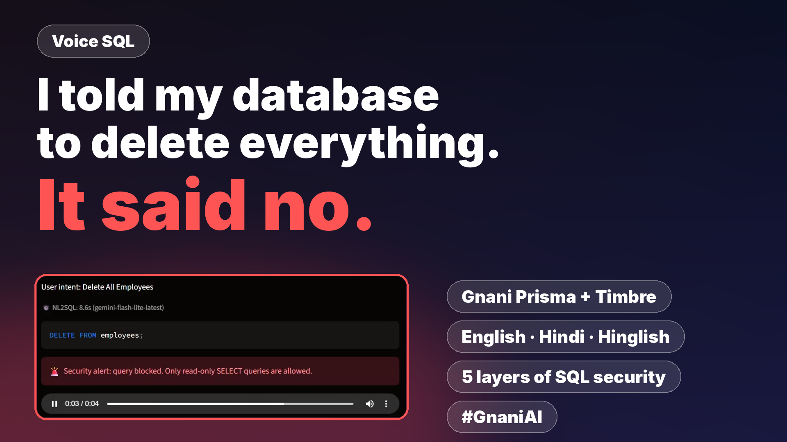

# 🎙️ Voice SQL

Ask your company data questions **in English, Hindi or Hinglish, by voice**, and get a spoken answer back, with security layers that never trust the AI's SQL.

Built for the **Great Indian AI Internship Challenge** by Gnani.ai.
`#GnaniAI #GreatIndianAIInternshipChallenge`

📄 **One-page solution pitch: [PITCH.pdf](PITCH.pdf)**



**Demo video:** _add your LinkedIn / X post link here_

## How it works

```
Voice → Gnani Prisma (STT) → Gemini (NL → SQL) → Security layers → SQLite → Gemini (spoken summary) → Gnani Timbre (TTS)
```

| Component | Role |
|---|---|
| **Gnani Prisma** | Speech-to-text for English, Hindi and Hinglish |
| **Gnani Timbre** | Text-to-speech for answers and security alerts |
| **Google Gemini** | Translates the question into SQL and writes the spoken summary |
| **Streamlit + SQLite** | UI and a demo database (`employees`, `projects`) |

The LLM is pluggable. The security design treats it as untrusted, whichever model is used.

## Security design

1. **SQL validation:** single read-only statement, forbidden keywords, table allow-list, no system tables
2. **Database authorizer:** SQLite itself refuses anything except reading allowed tables and columns
3. **Read-only connection** with a 2 s time limit and a 100-row cap
4. **Role-based access:** the *Manager* role cannot read `employees.salary` (enforced inside the database)
5. **Input limits and per-session rate limiting**; audio size cap
6. **Output escaping** (no Markdown/HTML injection), **API-key redaction** in errors, and an **audit log**

### Known limitations
- Rate limiting is per browser session. Production needs a server-side gateway.
- Roles are a demo dropdown. Production needs real authentication (SSO/OIDC).
- Query results are sent to Gemini to write the spoken summary. Sensitive data would need a private or self-hosted model.
- Stored prompt injection (malicious text inside database rows) is only partially mitigated.

## Run it

```bash
pip install -r requirements.txt
```

Set your keys (never commit them):

```powershell
# Windows PowerShell
$env:GOOGLE_API_KEY="your-gemini-key"
$env:GNANI_API_KEY="your-gnani-key"
python -m streamlit run app.py
```

```bash
# macOS / Linux
export GOOGLE_API_KEY=... GNANI_API_KEY=...
python -m streamlit run app.py
```

Optional: `GEMINI_MODEL` (model name), `RATE_LIMIT` (requests per minute, default 8).

## Repo contents

| File | Purpose |
|---|---|
| `PITCH.pdf` | One-page solution pitch |
| `app.py` | The whole Streamlit app |
| `make_voiceover.py` | Optional: generates narration clips with Gnani Timbre (used for the demo video) |
| `requirements.txt` | Python dependencies |

## Try these
- "Engineering department mein sabse zyada salary kiska hai?"
- "Which projects are active and what is their budget?"
- As *Manager*: "Salary of Neha" → access denied
- "Delete all employees" → blocked, with a spoken alert
